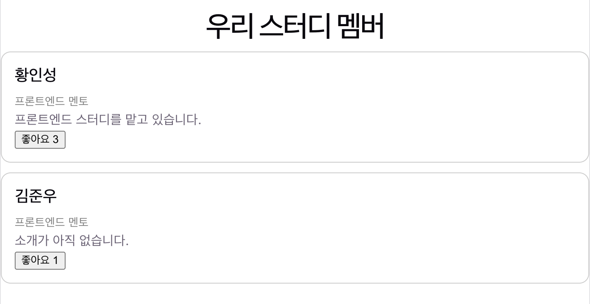
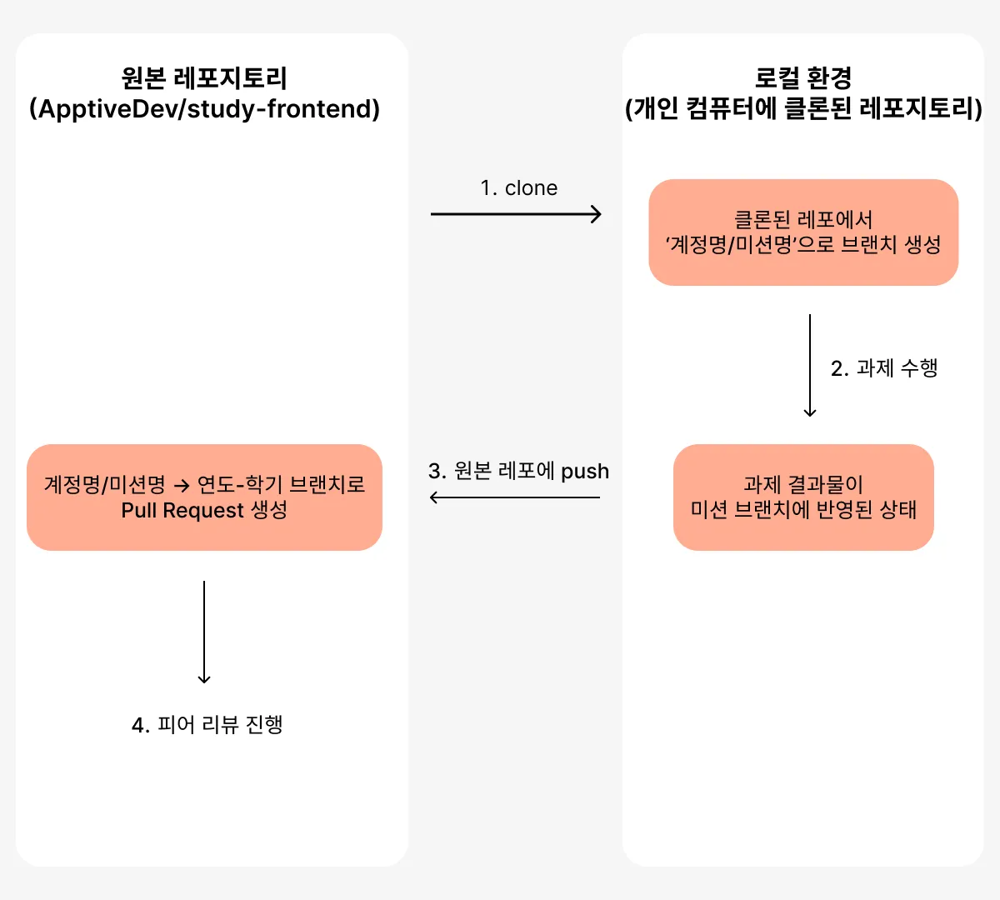

# TypeScript와 React 프로젝트 시작하기

이번 차시에는 React와 TypeScript로 프로젝트를 직접 만들고, 자기소개 카드 컴포넌트를 만들어 화면에 띄웁니다. 실습이 끝나면 아래 화면이 내 컴퓨터에서 실행되고 있어야 합니다.



## 이번 차시 목표

- Vite로 React와 TypeScript 프로젝트를 만들고 실행할 수 있습니다.
- props의 타입을 `type`으로 적은 컴포넌트를 만들고, 다른 props를 넘겨 여러 번 렌더링할 수 있습니다.
- 필수 prop이 빠졌을 때 나오는 타입 에러를 읽고 원인을 설명할 수 있습니다.
- `useState`로 버튼을 누를 때마다 바뀌는 값을 화면에 표시할 수 있습니다.

## 시작하기 전에

### HTML과 CSS가 처음이라면

이 스터디는 HTML 태그와 CSS 선택자를 한 번이라도 써 봤다고 가정합니다. 처음이라면 생활코딩 무료 강좌 두 개를 먼저 보고 와 주세요. 적어 둔 부분까지만 보면 충분합니다.

- [WEB1 - HTML & Internet](https://opentutorials.org/course/3084): "웹사이트 완성"까지
- [WEB2 - CSS](https://opentutorials.org/course/3086): "박스모델"까지

JavaScript는 써 본 적이 없어도 괜찮습니다. 필요한 문법은 실습에서 처음 쓸 때 설명합니다.

### 설치할 것

- [Git](https://git-scm.com/)
- [Node.js](https://nodejs.org/) LTS 버전
- [VS Code](https://code.visualstudio.com/): 쓰던 에디터가 있다면 그대로 써도 됩니다.
- pnpm: Node.js를 설치한 뒤 터미널에서 `npm install -g pnpm`을 실행합니다.

설치가 끝났다면 터미널에 아래 명령어를 한 줄씩 입력해 보세요. 세 명령어 모두 `v24.11.0`처럼 버전 숫자가 나오면 준비가 끝난 것입니다.

```sh
git --version
node -v
pnpm -v
```

> #### 버전 숫자 대신 오류가 나와요
>
> 설치 직후에는 터미널이 새로 설치한 프로그램을 아직 찾지 못하는 경우가 많습니다. 터미널을 완전히 껐다가 다시 켠 뒤에 한 번 더 입력해 보세요.

### 스터디 저장소 받기

과제는 모두 Git과 GitHub로 주고받습니다. 전체 흐름은 아래 그림과 같습니다.



지금은 저장소를 클론하고 브랜치를 만드는 데까지만 진행합니다. 나머지 과정은 문서 끝의 [과제 제출하기](#과제-제출하기)에서 이어집니다.

1. 저장소를 클론하고, 클론한 폴더로 이동합니다.

   ```sh
   git clone -b 2026-2 https://github.com/ApptiveDev/study-frontend.git
   cd study-frontend
   ```

2. `GitHub아이디/과제명` 형식으로 브랜치를 만듭니다. 이번 과제명은 `1-profile-card`이고, `GitHub아이디` 자리에는 본인 아이디를 넣어 주세요.

   ```sh
   git checkout -b GitHub아이디/1-profile-card
   ```

3. VS Code에서 [File] > [Open Folder]를 눌러 클론한 `study-frontend` 폴더를 엽니다.

## TypeScript와 React

HTML이 문서의 구조를, CSS가 모양을 맡는다면 JavaScript는 동작을 맡습니다. 버튼을 눌렀을 때 숫자를 올리는 것이 JavaScript가 하는 일입니다. TypeScript는 JavaScript에 타입을 붙인 언어입니다. 타입은 "이 자리에는 이런 값이 들어온다"는 약속이고, 약속을 어기면 코드를 실행하기 전에 에디터가 빨간 줄로 알려 줍니다.

HTML만으로 페이지를 만들 때는 비슷한 카드가 열 장 필요하면 같은 태그 묶음을 열 번 복사해야 했습니다. 내용이 바뀌면 열 군데를 고쳐야 했습니다. React에서는 그 태그 묶음을 컴포넌트로 한 번만 만들어 두고, 필요한 곳에서 불러다 씁니다.

이번 실습에서 두 가지를 모두 직접 확인합니다. 문법은 실습에서 처음 쓸 때 설명하고, 더 알아 두면 좋은 내용은 실습 뒤의 [개념 정리](#개념-정리)에 모았습니다.

## 실습

### 1. 프로젝트 만들기

React 프로젝트에는 시작할 때마다 똑같이 필요한 파일들이 있습니다. 이런 기본 틀을 보일러플레이트라고 하며, [Vite](https://ko.vite.dev)가 명령어 한 줄로 만들어 줍니다.

1. 터미널에서 클론한 저장소의 `projects` 폴더로 이동하고, 과제용 폴더를 만들어 그 안으로 들어갑니다.

   ```sh
   cd projects
   mkdir 1-profile-card
   cd 1-profile-card
   ```

2. Vite로 React와 TypeScript 프로젝트를 만듭니다. 마지막의 `.`은 지금 있는 폴더에 만들어 달라는 뜻입니다.

   ```sh
   pnpm create vite@latest . --template react-ts
   ```

   질문이 두 번 나옵니다. 두 번 모두 Enter를 눌러 기본값을 고르면 패키지 설치와 실행까지 이어집니다.

3. 터미널에 나온 주소 `http://localhost:5173`을 브라우저에서 엽니다. Vite 시작 화면이 보이면 성공입니다.

> #### `Ignored build scripts` 경고가 나와요
>
> 지금은 무시해도 됩니다. 프로젝트는 문제없이 실행됩니다.

터미널에서 `Ctrl + C`를 누르면 실행이 멈춥니다. 다시 실행할 때는 같은 폴더에서 `pnpm dev`를 입력합니다.

### 2. 만들어진 파일 둘러보기

파일이 많이 생겼지만 지금 알아야 하는 파일은 몇 개뿐입니다.

```
1-profile-card
├── index.html        브라우저가 가장 먼저 여는 파일. 빈 <div id="root">가 있습니다
├── package.json      설치한 패키지 목록과 pnpm dev 같은 명령어가 적혀 있습니다
└── src
    ├── main.tsx      빈 div 안에 React를 그리는 시작점
    ├── App.tsx       화면의 가장 바깥 컴포넌트. 이번 실습에서 고칠 파일입니다
    └── index.css     페이지 전체에 적용되는 CSS
```

`tsconfig.json`이나 `vite.config.ts` 같은 나머지 파일은 설정 파일입니다. 당분간은 열어 볼 일이 없습니다.

### 3. 카드 컴포넌트 만들기

`src` 안에 `components` 폴더를 만들고, 그 안에 파일 두 개를 만듭니다.

`src/components/profile-card.tsx`

```tsx
import './profile-card.css';

type ProfileCardProps = {
  name: string;
  role: string;
  intro?: string;
};

function ProfileCard({ name, role, intro = '소개가 아직 없습니다.' }: ProfileCardProps) {
  return (
    <div className="card">
      <h2>{name}</h2>
      <p className="role">{role}</p>
      <p>{intro}</p>
    </div>
  );
}

export default ProfileCard;
```

`src/components/profile-card.css`

```css
.card {
  border: 1px solid #ccc;
  border-radius: 12px;
  padding: 16px;
  margin: 12px 0;
  text-align: left;
}

.role {
  color: gray;
  font-size: 14px;
}
```

컴포넌트는 HTML처럼 생긴 것을 돌려주는 함수입니다. 처음 보는 문법을 위에서부터 하나씩 읽어 보겠습니다.

- `type ProfileCardProps = { ... }`: 이 카드가 받을 값의 모양에 이름을 붙입니다. `string`은 글자라는 뜻이고, 이름 뒤에 `?`가 붙은 `intro`는 없어도 되는 값입니다.
- `{ name, role, intro = '...' }`: 받은 값에서 세 값을 한 번에 꺼내는 문법으로, 구조 분해 할당이라고 부릅니다. `intro`가 없으면 `=` 뒤의 기본 문구를 씁니다.
- `return ( ... )`: 함수 안에 HTML처럼 쓰는 이 문법을 JSX라고 합니다. HTML의 `class` 대신 `className`을 쓰고, 중괄호 `{ }` 안에는 변수를 넣을 수 있습니다.
- `import`와 `export default`: 파일끼리 코드를 주고받는 문법입니다. `export`로 내보낸 것을 다른 파일에서 `import`로 가져옵니다.

### 4. 카드 여러 장 띄우기

`src/App.tsx`의 내용을 모두 지우고 아래 코드로 바꿉니다.

```tsx
import ProfileCard from './components/profile-card';

function App() {
  return (
    <main>
      <h1>우리 스터디 멤버</h1>
      <ProfileCard name="황인성" role="프론트엔드 멘토" intro="프론트엔드 스터디를 맡고 있습니다." />
      <ProfileCard name="김준우" role="프론트엔드 멘토" />
    </main>
  );
}

export default App;
```

컴포넌트는 HTML 태그처럼 쓰고, 속성 자리에 값을 넘깁니다. 이렇게 넘기는 값을 props라고 부르며, 앞에서 적은 `ProfileCardProps`가 바로 props의 타입입니다.

저장하면 브라우저가 새로고침 없이 바로 바뀝니다. 카드는 한 번만 만들었지만 화면에는 두 장이 나오고, `intro`를 넘기지 않은 두 번째 카드에는 기본 문구가 들어가 있으면 성공입니다. 첫 번째 카드의 이름과 역할을 본인 것으로 바꿔 보세요.

### 5. 일부러 틀려 보기

두 번째 카드에서 `role`을 지워 봅니다. 저장하기 전에 어떤 일이 생길지 먼저 예상해 보세요.

```tsx
<ProfileCard name="김준우" />
```

`ProfileCard`에 빨간 줄이 생깁니다. 마우스를 올리면 아래 메시지가 나옵니다.

```
Property 'role' is missing in type '{ name: string; }' but required in type 'ProfileCardProps'.
```

"`ProfileCardProps`에는 `role`이 꼭 있어야 하는데, 넘긴 값 `{ name: string; }`에는 빠져 있다"는 뜻입니다. 화면을 열어 역할이 왜 안 나오는지 찾아 헤매기 전에, 코드를 쓰는 순간 TypeScript가 알려 줍니다. 확인했다면 `role`을 다시 넣어 주세요.

### 6. 좋아요 버튼 달기

`profile-card.tsx`를 아래처럼 고칩니다. `// 추가`를 붙인 두 줄과 `<button>` 줄이 바뀌었습니다.

```tsx
import { useState } from 'react'; // 추가
import './profile-card.css';

type ProfileCardProps = {
  name: string;
  role: string;
  intro?: string;
};

function ProfileCard({ name, role, intro = '소개가 아직 없습니다.' }: ProfileCardProps) {
  const [likes, setLikes] = useState(0); // 추가

  return (
    <div className="card">
      <h2>{name}</h2>
      <p className="role">{role}</p>
      <p>{intro}</p>
      <button onClick={() => setLikes(likes + 1)}>좋아요 {likes}</button>
    </div>
  );
}

export default ProfileCard;
```

버튼을 누를 때마다 숫자가 1씩 올라가면 성공입니다.

- `useState(0)`: 0에서 시작해 바뀌는 값을 React에 맡깁니다. 이렇게 맡긴 값을 상태(state)라고 부릅니다. `likes`는 지금 값이고, `setLikes`는 값을 바꾸는 함수입니다.
- `const`: 값에 이름을 붙이는 문법입니다. `const`로 붙인 이름에는 다른 값을 다시 넣을 수 없습니다.
- `() => setLikes(likes + 1)`: 화살표 함수라고 부르는 짧은 함수입니다. 버튼이 눌리면 이 함수가 실행됩니다.

`setLikes`로 state를 바꾸면 React가 화면을 다시 그립니다. 자세한 동작은 다음 차시에 다룹니다.

첫 번째 카드의 좋아요를 세 번 누르면 두 번째 카드의 숫자는 몇이 될까요? 예상해 본 뒤 직접 눌러 확인해 보세요.

<details>
<summary>답 확인하기</summary>

0입니다. 카드마다 `useState`가 따로 실행되므로, 카드 하나의 state는 다른 카드에 영향을 주지 않습니다.

</details>

## 개념 정리

실습에서 짧게 넘어간 내용을 조금 더 설명합니다. 예시 코드는 [TypeScript 플레이그라운드](https://www.typescriptlang.org/play)에 붙여 넣으면 설치 없이 확인할 수 있습니다.

### JavaScript를 먼저 배워야 하나요?

따로 배우고 올 필요는 없습니다. TypeScript는 JavaScript에 타입 표기만 더한 언어라서, TypeScript를 배우면 JavaScript도 함께 배우게 됩니다. 오히려 처음부터 타입과 함께 배우는 쪽이 편합니다. 내가 잘못 쓴 코드도, AI가 그럴듯하게 틀리게 써 준 코드도 타입이 먼저 걸러 주기 때문입니다.

### 타입은 생략할 수 있습니다

값을 바로 넣으면 타입을 적지 않아도 TypeScript가 값을 보고 타입을 알아냅니다. 이를 타입 추론이라고 합니다. 아래 코드에서 `age`에 마우스를 올리면 `number`라고 나옵니다.

```ts
let age = 21;

age = 22;
age = '스물둘'; // 빨간 줄: number 자리에 글자를 넣을 수 없습니다
```

`let`은 `const`와 달리 나중에 다른 값을 넣을 수 있는 이름을 만듭니다. 그래서 실제 코드에서 타입을 직접 적는 곳은 생각보다 적습니다. 실습에서 본 props처럼 바깥에서 값이 들어오는 자리가 대표적입니다.

### 유니언 타입

`|`는 "이 중 하나"라는 뜻입니다. 정해진 선택지만 받고 싶을 때 씁니다.

```ts
type Size = 'small' | 'medium' | 'large';

let size: Size = 'small';
size = 'huge'; // 빨간 줄: 선택지에 없는 값입니다
```

### Node.js와 pnpm

JavaScript는 원래 웹 브라우저 안에서만 실행되는 언어입니다. Node.js는 브라우저 없이 내 컴퓨터에서 JavaScript를 실행하게 해 주는 프로그램이고, Vite처럼 React 프로젝트를 만들고 실행하는 도구는 모두 Node.js 위에서 동작합니다.

pnpm은 다른 사람이 만들어 둔 코드인 패키지를 내려받고 관리하는 패키지 매니저입니다. React도 pnpm으로 내려받는 패키지 중 하나입니다.

## 핵심 정리

- `pnpm create vite`로 프로젝트를 만들고, `pnpm dev`로 실행합니다.
- 컴포넌트는 JSX를 돌려주는 함수이고, props로 값을 받습니다. props의 모양은 `type`으로 적습니다.
- 필수 prop을 빠뜨리면 실행하기 전에 타입 에러로 알 수 있습니다.
- `useState`로 만든 state를 바꾸면 화면이 다시 그려지고, state는 컴포넌트마다 따로 있습니다.

## 과제: 자기소개 카드 완성하기

실습에서 만든 프로젝트를 이어서 우리 스터디의 자기소개 페이지를 만듭니다. 다음 차시 시작 전까지 PR로 제출해 주세요.

### 기능 요구 사항

- 카드를 세 장 이상 화면에 띄웁니다. 그중 한 장은 본인 카드입니다.
- 카드에 학과나 관심 분야처럼 실습에 없던 정보를 하나 이상 추가해 화면에 표시합니다.
- 카드마다 좋아요 버튼이 따로 동작합니다.

### 프로그래밍 요구 사항

- 추가한 정보는 `ProfileCard`의 props로 넘기고, `ProfileCardProps`에 타입을 적습니다. `any` 타입은 쓰지 않습니다.
- 컴포넌트 파일은 `src/components` 폴더에 둡니다.
- `pnpm build`가 에러 없이 끝납니다. 이 명령은 타입 에러가 있으면 실패합니다.
- `projects/1-profile-card` 밖의 파일은 수정하지 않습니다.

### 과제 진행 요구 사항

- PR 본문의 필수 항목을 모두 채웁니다. 본문 형식은 PR을 만들 때 자동으로 들어가고, 선택 항목은 비워 두거나 지워도 됩니다.
- 실습 5단계에서 본 타입 에러 메시지가 무슨 뜻인지, 왜 생겼는지 PR 본문의 "조사해 보기" 항목에 한두 문장으로 설명합니다.
- 커밋은 기능 하나에 하나씩 나누기를 권장합니다.

CSS는 자유롭게 꾸며도 됩니다. 디자인은 요구 사항에 들어가지 않습니다.

### 더 알아보기

선택 과제입니다. 했다면 항목마다 적힌 결과를 PR 본문에 남겨 주세요.

- 유니언 타입으로 `color` prop을 만들고, 카드마다 테두리 색을 다르게 줍니다. 선택지에 없는 색을 넘겼을 때 나오는 에러 메시지를 PR 본문에 붙여 넣어 주세요.
- 좋아요를 취소하는 버튼을 추가합니다. 숫자가 0 아래로 내려가지 않아야 합니다. 0에서 취소를 누르면 어떻게 되는지, 어떤 코드로 막았는지 PR 본문에 설명해 주세요.

### 조사해 보기

답은 PR 본문의 "조사해 보기" 항목에 3–5문장으로 적어 주세요. 다음 차시를 시작할 때 몇 명의 답을 함께 읽어 봅니다.

- 필수: 브라우저는 `.tsx` 파일을 바로 실행하지 못합니다. 그 이유는 무엇이고, Vite는 그 사이에서 어떤 일을 하나요? 앞으로 계속 쓸 개발 도구가 무슨 일을 하는지 알아 두기 위한 질문입니다.
- 선택: 객체의 모양을 적는 방법에는 `type` 말고 `interface`도 있습니다. 둘은 무엇이 다른가요?
- 선택: 예전에는 `let`과 `const` 대신 `var`를 썼습니다. 지금은 왜 잘 쓰지 않나요?

### AI를 쓸 때

AI는 써도 됩니다. 다만 어떻게 쓰는지에 따라 배우는 양이 달라집니다.

- 개념을 묻거나, 에러 메시지의 뜻을 묻거나, 내가 쓴 코드를 설명해 달라고 하는 것은 권장합니다.
- 과제 요구 사항을 통째로 붙여 넣고 코드를 받으면 이번 차시 목표를 건너뛰게 됩니다. AI에게 작업을 통째로 맡긴 사람은 코드를 읽고 디버깅하는 능력을 덜 익혔다는 [연구 결과](https://arxiv.org/abs/2601.20245)도 있습니다.
- 받은 코드는 붙여 넣기 전에 두 가지를 읽어 보세요. 컴포넌트가 무엇을 받는지 적힌 props 타입이 내가 원한 모양인지, 새 파일이 어느 폴더에 생기고 어디에서 `import`하는지입니다.
- 질문할 때는 만들고 싶은 것을 한 문장으로 쓰고, 관련 파일의 코드 전체와 에러 메시지 원문을 함께 붙여 주세요. 받은 코드에 모르는 줄이 있으면 그 줄이 무슨 뜻인지 한 번 더 물어보세요.

AI에게 물어본 것이 있다면 PR 본문의 "AI에게 물어본 것" 항목에 한두 줄로 적어 주세요. 평가에는 쓰지 않고, 리뷰할 때 이야기할 거리로 씁니다.

## 과제 제출하기

1. 작업한 내용을 커밋합니다.

   ```sh
   git add .
   git commit -m "커밋 메시지"
   ```

2. 작업한 브랜치를 원격 저장소에 push합니다.

   ```sh
   git push origin GitHub아이디/1-profile-card
   ```

3. GitHub에서 내 브랜치를 `2026-2` 브랜치로 보내는 Pull Request를 만듭니다. PR 제목은 `[기수] 이름 - 1차시 과제` 형식으로 적고, 본문은 자동으로 들어간 항목을 채웁니다.

4. 멘토가 코드를 리뷰합니다. 리뷰 코멘트 앞에는 아래 라벨이 붙습니다.

   - `[필수]`: 고쳐야 통과합니다.
   - `[권장]`: 고치면 더 좋아지는 부분입니다.
   - `[참고]`: 알아 두면 좋은 내용입니다. 고치지 않아도 됩니다.
   - `[칭찬]`: 잘한 부분입니다.

   `[필수]` 코멘트를 반영할 때는 새 PR을 만들지 않고, 같은 브랜치에 커밋을 추가로 push해 주세요.

5. 멘토가 Approve하면 과제를 통과한 것입니다.

> #### 내 PR이 머지되지 않았어요
>
> 머지 여부는 통과와 관계없습니다. 모든 직군이 이 저장소에서 동시에 협업 스터디를 진행하기 때문에, 과제마다 브랜치 하나만 골라 `2026-2`에 머지하고 다음 기수가 참고할 예시로 남깁니다. 나머지 PR은 다음 차시 시작 전에 닫습니다.
>
> 모든 PR이 같은 `projects/1-profile-card` 폴더를 수정하므로, PR 화면에 충돌이 표시되어도 정상입니다.

## 문제가 생겼다면

### `localhost:5173`이 열리지 않아요

1. `pnpm dev`를 실행한 터미널이 아직 켜져 있는지 확인합니다. `Ctrl + C`로 멈췄다면 다시 실행합니다.
2. 터미널에 나온 주소의 포트 번호를 확인합니다. 5173번을 다른 프로그램이 쓰고 있으면 5174번처럼 다른 번호가 나옵니다.

### 고쳤는데도 빨간 줄이 사라지지 않아요

1. 파일을 저장했는지 확인합니다. 저장하지 않은 파일은 탭 이름 옆에 동그라미가 표시됩니다.
2. 그래도 남아 있다면 VS Code에서 [View] > [Command Palette]를 열고 `TypeScript: Restart TS Server`를 실행합니다.
