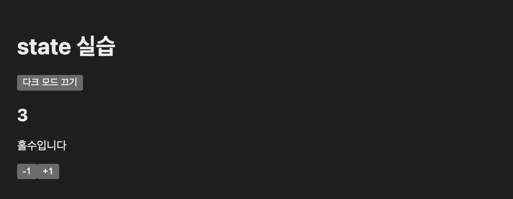
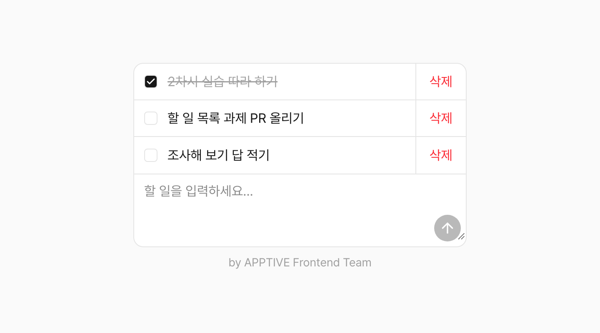

# state 중심으로 React 이해하기

이번 차시의 주제는 "React는 state를 중심으로 동작한다"입니다. 같은 카운터를 HTML과 JavaScript로 한 번, React로 한 번 만들어 비교하고, 다크 모드를 만들면서 state를 브라우저와 맞추고 여러 컴포넌트에 나눠 주는 방법을 배웁니다. 실습이 끝나면 아래 화면이 내 컴퓨터에서 실행되고 있어야 합니다.



## 이번 차시 목표

- state 없이 화면을 직접 고치는 코드와 state로 화면을 그리는 코드가 어떻게 다른지 설명할 수 있습니다.
- state를 새 값으로 바꾸면 컴포넌트 함수가 다시 실행되어 화면이 바뀐다는 것을 콘솔로 확인할 수 있습니다.
- `useEffect`로 state를 React 바깥의 브라우저 기능과 맞출 수 있습니다.
- props로 state를 여러 단계 내려줄 때 생기는 문제를 설명하고, Context로 바꿀 수 있습니다.

## 시작하기 전에

이번 실습은 제출하지 않습니다. 과제와 섞이지 않도록 `study-frontend` 저장소 밖에 실습 폴더를 만들어 주세요. 홈 폴더처럼 찾기 쉬운 곳이면 됩니다.

```sh
mkdir state-practice
cd state-practice
```

과제는 저장소 안의 `projects/2-todo-list`에서 진행합니다. 과제를 시작하는 방법은 [과제 시작하기](#과제-시작하기)에 있습니다.

## 화면은 state의 결과입니다

1차시에서 좋아요 버튼을 누르면 숫자가 올라갔습니다. 우리가 한 일은 `setLikes`로 숫자를 바꾼 것뿐이고, 화면의 숫자를 고치는 코드는 쓰지 않았습니다. React가 바뀐 state를 보고 화면을 다시 그렸기 때문입니다.

이번 차시에서는 이 동작을 자세히 봅니다. 먼저 state가 없는 일반 JavaScript로 카운터를 만들어, React가 대신 해 주는 일이 무엇인지 확인합니다. 그다음 state를 브라우저 기능과 맞추는 방법과, 여러 컴포넌트가 같은 state를 쓰는 방법을 차례로 배웁니다.

문법은 실습에서 처음 쓸 때 설명하고, 동작 원리는 실습 뒤의 [개념 정리](#개념-정리)에 모았습니다.

## 실습

### 1. HTML과 JavaScript로 카운터 만들기

`state-practice` 폴더에 `counter.html` 파일을 만들고 아래 코드를 붙여 넣습니다.

```html
<!doctype html>
<html lang="ko">
  <head>
    <meta charset="UTF-8" />
    <title>카운터</title>
  </head>
  <body>
    <h2 id="count">0</h2>
    <p id="parity">짝수입니다</p>
    <button id="minus" disabled>-1</button>
    <button id="plus">+1</button>

    <script>
      let count = 0;

      const countText = document.querySelector('#count');
      const parityText = document.querySelector('#parity');
      const minusButton = document.querySelector('#minus');
      const plusButton = document.querySelector('#plus');

      plusButton.addEventListener('click', () => {
        count = count + 1;
        countText.textContent = count;
        parityText.textContent = count % 2 === 0 ? '짝수입니다' : '홀수입니다';
        minusButton.disabled = count === 0;
      });

      minusButton.addEventListener('click', () => {
        count = count - 1;
        countText.textContent = count;
        parityText.textContent = count % 2 === 0 ? '짝수입니다' : '홀수입니다';
        minusButton.disabled = count === 0;
      });
    </script>
  </body>
</html>
```

파일을 브라우저 창으로 끌어다 놓아 엽니다. [+1]을 누르면 숫자와 "짝수입니다/홀수입니다" 문구가 바뀌고, 숫자가 0이면 [-1]이 눌리지 않으면 성공입니다.

- `<script>`: HTML 안에 JavaScript를 쓰는 태그입니다. 브라우저는 페이지를 열 때 이 안의 코드를 실행합니다.
- `document.querySelector('#count')`: CSS 선택자로 화면의 태그를 찾아옵니다. `#count`는 `id="count"`인 태그입니다.
- `addEventListener('click', ...)`: 태그가 클릭될 때마다 실행할 함수를 등록합니다.
- `textContent`, `disabled`: 찾아온 태그의 글자와 비활성화 여부입니다. 값을 넣으면 화면이 바로 바뀝니다.
- `조건 ? A : B`: 조건이 참이면 A, 거짓이면 B가 되는 식으로, 삼항 연산자라고 부릅니다.

이제 숫자를 0으로 되돌리는 [초기화] 버튼을 직접 추가해 보세요. 버튼 태그를 하나 만들고, 클릭했을 때 실행할 코드를 적으면 됩니다.

<details>
<summary>예시 코드 보기</summary>

```html
<button id="reset">초기화</button>
```

```js
const resetButton = document.querySelector('#reset');

resetButton.addEventListener('click', () => {
  count = 0;
  countText.textContent = count;
  parityText.textContent = count % 2 === 0 ? '짝수입니다' : '홀수입니다';
  minusButton.disabled = count === 0;
});
```

</details>

추가하면서 같은 세 줄을 또 적었을 것입니다. 이 코드에서는 `count`를 바꿀 때마다, `count`를 보여 주는 화면을 모두 직접 고쳐야 합니다. 화면에 `count`를 쓰는 곳이 하나 더 생기면 버튼 세 개의 코드를 모두 고쳐야 하고, 한 곳이라도 빠뜨리면 숫자와 문구가 서로 다른 값을 보여 줍니다.

### 2. React로 다시 만들기

1. `state-practice` 폴더에서 React 프로젝트를 만듭니다. 1차시와 같이 질문에 모두 Enter를 누르면 실행까지 이어집니다.

   ```sh
   pnpm create vite@latest react-counter --template react-ts
   ```

   프로젝트는 `react-counter` 폴더에 만들어집니다. 실행을 멈췄다가 다시 실행할 때는 `cd react-counter`로 이 폴더에 들어간 뒤 `pnpm dev`를 입력합니다.

2. `src/components/counter.tsx`를 만듭니다.

   ```tsx
   import { useState } from 'react';

   function Counter() {
     const [count, setCount] = useState(0);
     console.log('Counter 렌더링:', count);

     return (
       <div>
         <h2>{count}</h2>
         <p>{count % 2 === 0 ? '짝수입니다' : '홀수입니다'}</p>
         <button onClick={() => setCount(count - 1)} disabled={count === 0}>
           -1
         </button>
         <button onClick={() => setCount(count + 1)}>+1</button>
       </div>
     );
   }

   export default Counter;
   ```

3. `src/App.tsx`의 내용을 모두 지우고 아래 코드로 바꿉니다.

   ```tsx
   import Counter from './components/counter';

   function App() {
     return (
       <main>
         <Counter />
       </main>
     );
   }

   export default App;
   ```

1단계의 카운터와 똑같이 동작하면 성공입니다.

두 코드를 비교해 보세요. React 코드에는 화면을 고치는 코드가 없습니다. JSX는 "`count`가 이 값이면 화면은 이렇게 생겼다"는 설명이고, 버튼은 `count`만 바꿉니다. 나머지는 React가 맡습니다.

이번에는 [초기화] 버튼을 React 코드에 추가해 보세요. 한 줄이면 됩니다.

```tsx
<button onClick={() => setCount(0)}>초기화</button>
```

브라우저에서 `F12`(macOS는 `Cmd + Option + I`)를 눌러 개발자 도구를 열고 [Console] 탭을 고릅니다. 버튼을 누를 때마다 `Counter 렌더링:`이 새 숫자와 함께 찍힙니다. state가 바뀌면 React가 `Counter` 함수를 처음부터 다시 실행하고, 그 결과로 화면을 고친다는 뜻입니다. 이것을 렌더링이라고 부릅니다.

> #### 콘솔에 같은 줄이 두 번씩 찍혀요
>
> 정상입니다. `main.tsx`의 `<StrictMode>`가 개발 중에만 컴포넌트를 한 번 더 실행해서 실수를 찾아 줍니다.

[+1] 버튼 옆에 아래 버튼을 추가하고 눌러 보세요. 숫자는 얼마나 올라갈까요? 예상해 본 뒤 직접 확인해 보세요.

```tsx
<button
  onClick={() => {
    setCount(count + 1);
    setCount(count + 1);
    setCount(count + 1);
  }}
>
  +3
</button>
```

<details>
<summary>답 확인하기</summary>

1만 올라갑니다. `setCount`는 `count`를 그 자리에서 바꾸지 않고, 다음 렌더링에서 쓸 값을 React에 맡깁니다. 이번 렌더링의 `count`가 0이라면 세 줄은 모두 `setCount(0 + 1)`입니다. 앞의 결과에 이어서 더하려면 `setCount((prev) => prev + 1)`처럼 함수를 넘깁니다. 자세한 내용은 [렌더링은 컴포넌트 함수를 다시 실행하는 일입니다](#렌더링은-컴포넌트-함수를-다시-실행하는-일입니다)에 있습니다.

</details>

확인했다면 [초기화]와 [+3] 버튼은 지워 주세요.

### 3. 다크 모드 만들기

이번에는 다크 모드 버튼을 만듭니다. 테마도 사용자가 바꾸는 값이므로 state로 만듭니다.

1. `src/index.css`의 내용을 모두 지우고 아래 코드로 바꿉니다. `body` 태그에 `dark` 클래스가 붙으면 배경과 글자색이 바뀌고, `color-scheme: dark`가 버튼 같은 기본 요소도 어두운 색으로 바꿉니다.

   ```css
   body {
     margin: 0;
     padding: 24px;
     font-family: system-ui, sans-serif;
     background: #ffffff;
     color: #111111;
   }

   body.dark {
     background: #1e1e1e;
     color: #eeeeee;
     color-scheme: dark;
   }
   ```

2. `src/App.tsx`를 아래 코드로 바꿉니다.

   ```tsx
   import { useEffect, useState } from 'react';
   import Counter from './components/counter';

   type Theme = 'light' | 'dark';

   function App() {
     const [theme, setTheme] = useState<Theme>('light');

     useEffect(() => {
       document.body.className = theme;
     }, [theme]);

     return (
       <main>
         <button onClick={() => setTheme(theme === 'light' ? 'dark' : 'light')}>
           {theme === 'light' ? '다크 모드 켜기' : '다크 모드 끄기'}
         </button>
         <Counter />
       </main>
     );
   }

   export default App;
   ```

[다크 모드 켜기]를 누르면 화면 전체가 어두워지고 버튼 글자가 [다크 모드 끄기]로 바뀌면 성공입니다.

- `type Theme = 'light' | 'dark'`: 1차시 개념 정리에서 본 유니언 타입입니다. 테마에는 두 값만 들어갈 수 있습니다.
- `useState<Theme>('light')`: state에 들어갈 값의 타입을 꺾쇠 `< >` 안에 적습니다.
- `useEffect(함수, [theme])`: 화면을 그린 뒤에 함수를 실행합니다. 두 번째 값인 `[theme]`은 의존성 배열이라고 부르며, `theme`이 지난번과 달라졌을 때만 다시 실행하라는 뜻입니다.
- `document.body.className = theme`: `body` 태그의 클래스를 바꿉니다. 1단계에서 쓴 `textContent`처럼 화면을 직접 고치는 코드입니다.

화면을 직접 고치는 코드가 다시 나왔습니다. React가 그리는 곳은 `index.html`의 `<div id="root">` 안쪽뿐이고, `body`는 그 바깥에 있기 때문입니다. 이렇게 React 바깥에 있는 것을 state와 맞출 때 `useEffect`를 씁니다. `theme`만 바꾸면 Effect가 `body`를 따라 바꿔 주므로, 버튼 코드는 여전히 state만 바꿉니다.

### 4. 새로고침해도 테마 유지하기

다크 모드를 켜고 새로고침해 보세요. 밝은 화면으로 돌아갑니다. state는 페이지를 새로고침하면 처음 값으로 돌아가기 때문입니다.

브라우저에는 localStorage라는 작은 저장 공간이 있습니다. 여기에 넣은 값은 새로고침하거나 브라우저를 껐다 켜도 남아 있습니다. `App.tsx`의 `useState`와 `useEffect`를 아래처럼 고칩니다.

```tsx
const [theme, setTheme] = useState<Theme>(() =>
  localStorage.getItem('theme') === 'dark' ? 'dark' : 'light',
);

useEffect(() => {
  document.body.className = theme;
  localStorage.setItem('theme', theme);
}, [theme]);
```

다크 모드를 켜고 새로고침했을 때 어두운 화면이 그대로 남아 있으면 성공입니다. 개발자 도구의 [Application] > [Local Storage] > `http://localhost:5173`을 고르면 저장된 `theme` 값도 볼 수 있습니다.

- `localStorage.setItem('theme', theme)`: `theme`이라는 이름으로 값을 저장합니다. 저장도 React 바깥의 일이라 Effect 안에 둡니다.
- `localStorage.getItem('theme')`: 저장한 값을 꺼냅니다. 저장한 적이 없으면 `null`이 나옵니다.
- `useState(() => ...)`: 첫 값 대신 함수를 넘기면, React는 처음 렌더링할 때 한 번만 그 함수를 실행해 첫 값을 정합니다. 함수로 감싸지 않으면 렌더링할 때마다 localStorage를 읽게 됩니다.

### 5. 테마를 props로 내려주기

화면 위쪽에 제목과 테마 버튼이 있는 머리글을 만듭니다. `App` 안에 `Header`가, `Header` 안에 `ThemeButton`이 들어갑니다.

1. 여러 파일에서 테마 타입을 쓰도록 `src/theme.ts`를 만들어 타입을 옮깁니다. `App.tsx`에 있던 `type Theme = ...` 줄은 지웁니다.

   ```ts
   export type Theme = 'light' | 'dark';
   ```

2. `src/components/theme-button.tsx`를 만듭니다.

   ```tsx
   import type { Theme } from '../theme';

   type ThemeButtonProps = {
     theme: Theme;
     onToggle: () => void;
   };

   function ThemeButton({ theme, onToggle }: ThemeButtonProps) {
     return (
       <button onClick={onToggle}>{theme === 'light' ? '다크 모드 켜기' : '다크 모드 끄기'}</button>
     );
   }

   export default ThemeButton;
   ```

3. `src/components/header.tsx`를 만듭니다.

   ```tsx
   import type { Theme } from '../theme';
   import ThemeButton from './theme-button';

   type HeaderProps = {
     theme: Theme;
     onToggleTheme: () => void;
   };

   function Header({ theme, onToggleTheme }: HeaderProps) {
     return (
       <header>
         <h1>state 실습</h1>
         <ThemeButton theme={theme} onToggle={onToggleTheme} />
       </header>
     );
   }

   export default Header;
   ```

4. `App.tsx`에서 `Header`를 불러오고, 테마를 바꾸는 `toggleTheme` 함수를 만들어 넘깁니다. 바뀐 곳이 여러 군데이므로 파일 전체를 아래 코드로 바꿉니다.

   ```tsx
   import { useEffect, useState } from 'react';
   import Counter from './components/counter';
   import Header from './components/header';
   import type { Theme } from './theme';

   function App() {
     const [theme, setTheme] = useState<Theme>(() =>
       localStorage.getItem('theme') === 'dark' ? 'dark' : 'light',
     );

     useEffect(() => {
       document.body.className = theme;
       localStorage.setItem('theme', theme);
     }, [theme]);

     function toggleTheme() {
       setTheme(theme === 'light' ? 'dark' : 'light');
     }

     return (
       <main>
         <Header theme={theme} onToggleTheme={toggleTheme} />
         <Counter />
       </main>
     );
   }

   export default App;
   ```

머리글이 생기고 다크 모드가 3단계와 똑같이 동작하면 성공입니다.

- `onToggle: () => void`: 아무것도 받지 않고 아무것도 돌려주지 않는 함수라는 타입입니다. 함수도 props로 넘길 수 있습니다.
- `import type`: 타입만 가져올 때 씁니다.

동작은 같지만 `Header`를 다시 읽어 보세요. `Header`는 `theme`과 `onToggleTheme`을 쓰지 않습니다. `ThemeButton`에 전해 주려고 받기만 합니다. 버튼이 다섯 단계 아래에 있다면 중간의 컴포넌트 네 개가 모두 이 props를 받아 넘겨야 합니다. 쓰지도 않는 props를 단계마다 받아 넘기는 이 상황을 prop drilling이라고 부릅니다.

### 6. Context로 바꾸기

Context를 쓰면 중간 컴포넌트를 거치지 않고, 위에서 넣어 둔 값을 아래 어디서든 꺼내 쓸 수 있습니다.

1. `src/theme.ts`에 Context를 만듭니다.

   ```ts
   import { createContext } from 'react';

   export type Theme = 'light' | 'dark';

   type ThemeContextValue = {
     theme: Theme;
     toggleTheme: () => void;
   };

   export const ThemeContext = createContext<ThemeContextValue>({
     theme: 'light',
     toggleTheme: () => {},
   });
   ```

2. `App.tsx`에서 `Header`에 넘기던 props를 지우고, 전체를 `<ThemeContext>`로 감쌉니다. `theme.ts`에서 가져오는 `import` 줄도 바뀌므로 파일 전체를 아래 코드로 바꿉니다.

   ```tsx
   import { useEffect, useState } from 'react';
   import Counter from './components/counter';
   import Header from './components/header';
   import { ThemeContext, type Theme } from './theme';

   function App() {
     const [theme, setTheme] = useState<Theme>(() =>
       localStorage.getItem('theme') === 'dark' ? 'dark' : 'light',
     );

     useEffect(() => {
       document.body.className = theme;
       localStorage.setItem('theme', theme);
     }, [theme]);

     function toggleTheme() {
       setTheme(theme === 'light' ? 'dark' : 'light');
     }

     return (
       <ThemeContext value={{ theme, toggleTheme }}>
         <main>
           <Header />
           <Counter />
         </main>
       </ThemeContext>
     );
   }

   export default App;
   ```

   - `import { ThemeContext, type Theme }`: 값인 `ThemeContext`와 타입인 `Theme`을 한 줄에서 함께 가져옵니다. 타입 앞에는 `type`을 붙입니다.

3. `header.tsx`에서는 props를 모두 지웁니다.

   ```tsx
   import ThemeButton from './theme-button';

   function Header() {
     return (
       <header>
         <h1>state 실습</h1>
         <ThemeButton />
       </header>
     );
   }

   export default Header;
   ```

4. `theme-button.tsx`는 props 대신 Context에서 값을 꺼냅니다.

   ```tsx
   import { useContext } from 'react';
   import { ThemeContext } from '../theme';

   function ThemeButton() {
     const { theme, toggleTheme } = useContext(ThemeContext);

     return (
       <button onClick={toggleTheme}>
         {theme === 'light' ? '다크 모드 켜기' : '다크 모드 끄기'}
       </button>
     );
   }

   export default ThemeButton;
   ```

다크 모드가 5단계와 똑같이 동작하면 성공입니다. 이제 `Header`는 테마를 전혀 모릅니다.

- `createContext(기본값)`: Context를 만듭니다. 기본값은 `<ThemeContext>`로 감싸지 않은 곳에서 값을 꺼낼 때 쓰입니다.
- `<ThemeContext value={...}>`: 이 태그 안쪽의 모든 컴포넌트에 `value`를 전해 줍니다.
- `useContext(ThemeContext)`: 가장 가까운 `<ThemeContext>`가 전해 준 값을 꺼냅니다.

state는 여전히 `App` 한 곳에 있습니다. Context는 state를 새로 만드는 도구가 아니라, 이미 있는 state를 멀리 있는 컴포넌트까지 전하는 도구입니다.

## 개념 정리

실습에서 짧게 넘어간 내용을 조금 더 설명합니다.

### 렌더링은 컴포넌트 함수를 다시 실행하는 일입니다

`setCount`를 호출하면 React는 `Counter` 함수를 처음부터 다시 실행하고, 돌려받은 JSX와 지금 화면을 비교해서 달라진 곳만 고칩니다. 다시 실행된 함수 안에서 `useState`는 React가 맡아 두었던 새 값을 돌려줍니다.

그래서 한 번의 렌더링 안에서 `count`는 바뀌지 않습니다. 2단계의 [+3] 버튼이 1만 올린 이유입니다. 사진을 찍듯 렌더링 순간의 값이 고정된다는 뜻에서, React 공식 문서는 이를 [스냅샷으로서의 state](https://ko.react.dev/learn/state-as-a-snapshot)라고 부릅니다.

### state는 새 값으로 바꿉니다

React는 `set` 함수로 받은 값이 지금 값과 같은지 비교하고, 같으면 다시 렌더링하지 않습니다. 숫자나 글자는 늘 새 값이 들어가니 문제가 없지만, 배열과 객체는 조심해야 합니다.

```tsx
const [names, setNames] = useState(['황인성', '김준우']);

names.push('이세형'); // 같은 배열의 안쪽만 바뀝니다
setNames(names); // 같은 배열이므로 화면이 그대로입니다

setNames([...names, '이세형']); // 새 배열이므로 다시 그립니다
```

`[...names, '이세형']`의 `...`은 배열의 값을 그 자리에 펼치는 문법으로, 전개 구문이라고 부릅니다. 기존 값을 모두 펼치고 끝에 하나를 붙인 새 배열을 만듭니다. 과제에서 배열을 다룰 때 가장 많이 만나는 문제이니 꼭 기억해 주세요.

### Effect는 React 바깥과 맞추는 코드입니다

컴포넌트 함수는 JSX를 돌려주는 일만 하는 것이 좋습니다. `body`나 localStorage처럼 React 바깥을 바꾸는 일은 화면을 그린 뒤에 실행되도록 `useEffect`에 넣습니다. 의존성 배열에 따라 실행되는 시점이 달라집니다.

```tsx
useEffect(() => { ... });          // 렌더링할 때마다
useEffect(() => { ... }, []);      // 처음 렌더링했을 때 한 번
useEffect(() => { ... }, [theme]); // 처음, 그리고 theme이 바뀔 때마다
```

Effect 안에서 쓰는 state와 props는 의존성 배열에 모두 적어야 합니다. 빠뜨리면 Effect가 오래된 값을 쓰게 됩니다.

타이머처럼 시작한 것을 멈춰야 하는 Effect는 정리 함수를 돌려줍니다. React는 Effect를 다시 실행하기 전과 컴포넌트가 화면에서 사라질 때 정리 함수를 실행합니다.

```tsx
const [seconds, setSeconds] = useState(0);

useEffect(() => {
  const id = setInterval(() => setSeconds((prev) => prev + 1), 1000);
  return () => clearInterval(id); // 타이머를 멈춥니다
}, []);
```

개발 중에는 Effect가 처음에 두 번 실행될 수 있습니다. `<StrictMode>`가 Effect를 실행하고, 정리하고, 다시 실행해서 정리 함수를 빠뜨리지 않았는지 확인하기 때문입니다. 자세한 내용은 React 공식 문서의 [Effect로 동기화하기](https://ko.react.dev/learn/synchronizing-with-effects)에 있습니다.

### Context보다 먼저 생각해 볼 것

prop drilling이 있다고 해서 바로 Context를 쓸 필요는 없습니다. 두세 단계 정도는 props로 넘기는 편이 데이터가 어디서 오는지 읽기 쉽습니다. 또 `<Header button={<ThemeButton ... />} />`처럼 컴포넌트를 통째로 props로 넘기면, 중간 컴포넌트가 값을 받아 넘길 필요가 없어지기도 합니다. Context는 테마나 로그인한 사용자처럼 앱 곳곳에서 쓰는 값에 알맞습니다.

## 핵심 정리

- React에서는 state만 바꾸고, 화면은 state를 보고 React가 다시 그립니다.
- state를 바꾸면 컴포넌트 함수가 다시 실행됩니다. 배열과 객체는 기존 값을 고치지 않고 새 값을 만들어 넘깁니다.
- `document`나 localStorage처럼 React 바깥을 state와 맞출 때는 `useEffect`를 쓰고, 의존성 배열로 실행 시점을 정합니다.
- 여러 단계 아래로 state를 전해야 할 때는 props 대신 Context를 쓸 수 있습니다.

## 과제: 할 일 목록 만들기

할 일을 추가하고, 완료 여부를 체크하고, 삭제할 수 있는 할 일 목록을 만듭니다. 다음 차시 시작 전까지 PR로 제출해 주세요.



이번 과제의 핵심은 배열 state입니다. 배열 state는 실습에서 다루지 않았습니다. [state는 새 값으로 바꿉니다](#state는-새-값으로-바꿉니다)의 원칙을 배열에 적용하는 방법을 아래 자료에서 찾아 직접 풀어 보는 과제입니다.

### 과제 시작하기

1. 클론해 둔 `study-frontend` 폴더에서 최신 `2026-2` 브랜치를 받고, 과제 브랜치를 만듭니다.

   ```sh
   git checkout 2026-2
   git pull
   git checkout -b GitHub아이디/2-todo-list
   ```

2. 과제 폴더로 이동해 패키지를 설치하고 실행합니다.

   ```sh
   cd projects/2-todo-list
   pnpm install
   pnpm dev
   ```

입력창만 있는 빈 카드가 보이면 준비가 끝난 것입니다. 설치 중에 `Ignored build scripts` 경고가 나오면 1차시처럼 무시해도 됩니다. `src/components`에는 입력창(`TodoInput`), 할 일 한 줄(`TodoItem`), 빈 목록 문구(`Placeholder`) 컴포넌트가 미리 만들어져 있습니다. `src/App.tsx`의 빈칸을 채워 이 컴포넌트들을 연결해 주세요.

처음에는 `App.tsx`에 쓰지 않는 변수와 함수 때문에 빨간 줄이 보입니다. 빈칸을 채우면 사라집니다. `className`에 적힌 값은 화면 모양을 정하는 [Tailwind CSS](https://tailwindcss.com/) 클래스입니다. 이번 과제에서는 몰라도 됩니다.

### 찾아볼 자료

- [목록 렌더링](https://ko.react.dev/learn/rendering-lists): 배열에 든 여러 데이터를 어떻게 컴포넌트로 그릴 수 있을까요?
- [조건부 렌더링](https://ko.react.dev/learn/conditional-rendering): 할 일이 있을 때와 없을 때 다른 화면을 보여 주려면 어떻게 해야 할까요?
- [배열 state 업데이트하기](https://ko.react.dev/learn/updating-arrays-in-state): 배열 state에 값을 추가하거나 빼려면 어떻게 해야 할까요?
- [객체 state 업데이트하기](https://ko.react.dev/learn/updating-objects-in-state): 할 일 하나의 `completed`만 바꾸려면 어떻게 해야 할까요?

### 기능 요구 사항

- 입력창에 할 일을 적고 화살표 버튼을 누르면 목록 맨 아래에 추가됩니다.
- 할 일을 누르면 완료 표시가 켜지고, 다시 누르면 꺼집니다.
- [삭제]를 누르면 그 할 일만 목록에서 사라집니다.
- 할 일이 하나도 없으면 "할 일이 없습니다."가 보입니다.

### 프로그래밍 요구 사항

- 할 일 목록은 `App`의 `todos` state 하나로 관리합니다.
- 제공된 `TodoInput`, `TodoItem`, `Placeholder` 컴포넌트를 사용합니다.
- state의 배열과 객체를 직접 바꾸지 않습니다. `push`, `splice`나 `todo.completed = true`처럼 값을 바로 바꾸는 코드를 state에 쓰지 않습니다.
- `key`에는 배열의 인덱스를 쓰지 않습니다.
- `any` 타입은 쓰지 않습니다.
- `pnpm build`가 에러 없이 끝납니다.
- `projects/2-todo-list` 밖의 파일은 수정하지 않습니다.

### 과제 진행 요구 사항

- PR 본문의 필수 항목을 모두 채웁니다.
- 커밋은 기능 하나에 하나씩 나누기를 권장합니다.

CSS는 자유롭게 꾸며도 됩니다. 디자인은 요구 사항에 들어가지 않습니다.

### 더 알아보기

선택 과제입니다. 했다면 항목마다 적힌 결과를 PR 본문에 남겨 주세요.

- 아직 끝내지 않은 할 일의 개수를 목록 위에 표시합니다. 개수를 state로 따로 만들지 않았다면, 어떻게 계산했는지 PR 본문에 설명해 주세요.
- [전체], [진행 중], [완료] 버튼으로 보이는 할 일을 거릅니다. 버튼을 바꿔도 `todos` state의 내용은 그대로여야 합니다. 어떻게 구현했는지 PR 본문에 설명해 주세요.
- 실습에서 만든 다크 모드를 Context로 이 앱에 붙입니다. 다크 모드를 켠 화면의 스크린샷을 PR 본문에 첨부해 주세요.

### 조사해 보기

답은 PR 본문의 "조사해 보기" 항목에 3–5문장으로 적어 주세요. 다음 차시를 시작할 때 몇 명의 답을 함께 읽어 봅니다.

- 필수: `key`는 무엇을 위한 값인가요? 배열의 인덱스를 `key`로 쓰면 어떤 때에 문제가 생기나요? 목록을 그릴 때마다 `key`를 고르게 되므로, `key`가 하는 일을 알아 두기 위한 질문입니다. [목록 렌더링](https://ko.react.dev/learn/rendering-lists) 문서에서 시작해 보세요.
- 선택: 실습 6단계에서 다크 모드를 켜면 콘솔에 `Counter 렌더링:`이 또 찍힙니다. `Counter`는 테마를 쓰지 않는데, 왜 다시 렌더링될까요?
- 선택: `document.body.className = theme;`을 `useEffect` 없이 컴포넌트 함수 안에 바로 써도 동작합니다. 그런데도 `useEffect`에 넣는 이유는 무엇인가요?

### AI를 쓸 때

AI를 쓰는 방법은 [1차시의 안내](../1-Project/README.md#ai를-쓸-때)와 같습니다. 이번 과제에서는 받은 코드에서 두 가지를 더 확인해 주세요.

- state를 바꾸는 코드가 `push`나 `todo.completed = true`처럼 원래 값을 바로 바꾸지 않는지 확인합니다.
- 코드의 각 줄이 [찾아볼 자료](#찾아볼-자료)의 어느 내용에 해당하는지 설명할 수 있는지 확인합니다. 설명할 수 없는 줄이 있다면 그 줄이 무슨 뜻인지 AI에게 한 번 더 물어보세요.

AI에게 물어본 것이 있다면 PR 본문의 "AI에게 물어본 것" 항목에 한두 줄로 적어 주세요.

## 과제 제출하기

제출 방법은 [1차시의 과제 제출하기](../1-Project/README.md#과제-제출하기)와 같습니다. 브랜치 이름은 `GitHub아이디/2-todo-list`이고, PR 제목은 `[기수] 이름 - 2차시 과제` 형식으로 적습니다.

```sh
git push origin GitHub아이디/2-todo-list
```

## 문제가 생겼다면

### `counter.html`을 열었더니 코드가 보여요

파일이 브라우저가 아닌 에디터로 열린 것입니다. 파일을 브라우저 창으로 끌어다 놓거나, 파일을 오른쪽 클릭해 [다음으로 열기]에서 브라우저를 골라 주세요.

### 고쳤는데도 화면이 바뀌지 않아요

state를 직접 바꾸고 있는지 확인합니다. `push`, `splice`를 쓰거나 `todo.completed = ...`처럼 값을 바로 넣었다면, [state는 새 값으로 바꿉니다](#state는-새-값으로-바꿉니다)를 보고 새 배열이나 새 객체를 만드는 코드로 바꿔 주세요.

### `localhost:5173`이 열리지 않아요

1차시의 [문제가 생겼다면](../1-Project/README.md#문제가-생겼다면)을 확인해 주세요.
