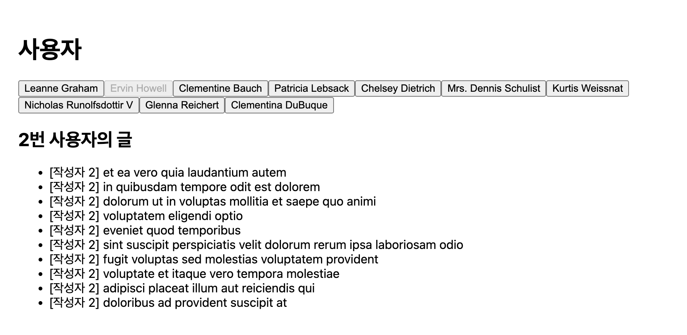
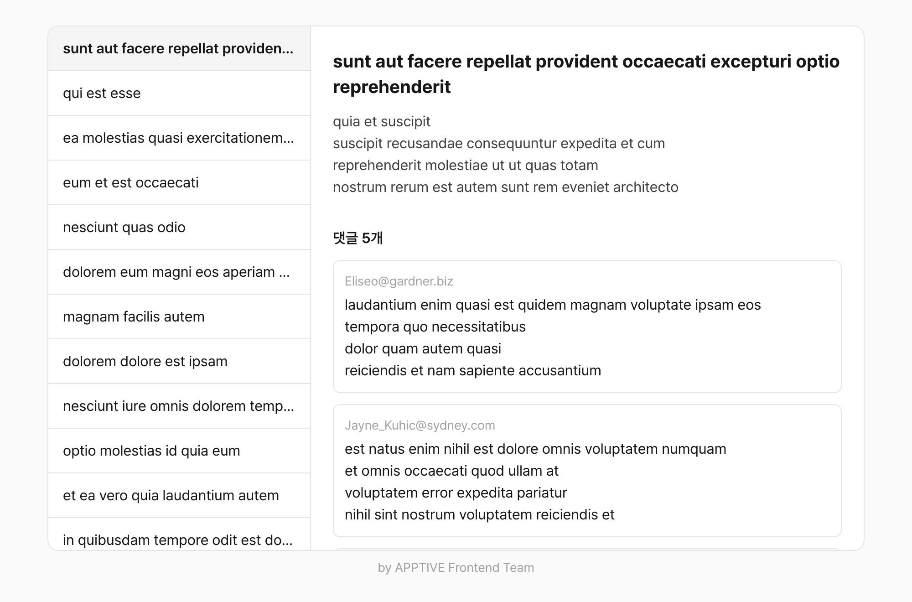

# 서버에서 데이터 가져오기

이번 차시에는 서버에서 사용자와 글 목록을 받아 화면에 그립니다. 같은 화면을 `useEffect`로 한 번, TanStack Query와 Suspense로 한 번 만들어 보고, 서버 데이터를 다룰 때 무엇이 어려운지와 라이브러리가 그 일을 어떻게 덜어 주는지 비교합니다. 실습이 끝나면 아래 화면이 내 컴퓨터에서 실행되고 있어야 합니다.



## 이번 차시 목표

- `fetch`와 `await`로 서버에서 JSON 데이터를 받아 올 수 있습니다.
- `useEffect`로 데이터를 요청하고, 불러오는 중, 실패, 성공 세 가지 화면을 나눠 보여 줄 수 있습니다.
- 요청이 겹칠 때 늦게 도착한 응답이 화면을 덮어쓰는 문제를 설명하고, Effect의 정리 함수로 막을 수 있습니다.
- 같은 화면을 TanStack Query와 Suspense로 다시 만들고, 무엇이 컴포넌트 바깥으로 빠졌는지 설명할 수 있습니다.

## 시작하기 전에

2차시처럼 이번 실습도 제출하지 않습니다. `study-frontend` 저장소 밖에 실습 폴더를 만들어 주세요. 2차시에 만든 `state-practice` 폴더를 그대로 써도 됩니다.

이번 실습은 인터넷에 연결되어 있어야 합니다. 실습에서 쓰는 서버는 [JSONPlaceholder](https://jsonplaceholder.typicode.com/)입니다. 연습용으로 만든 무료 API로, 가입이나 키 없이 사용자, 글, 댓글 같은 가짜 데이터를 돌려줍니다.

과제는 저장소 안의 `projects/3-post-viewer`에서 진행합니다. 과제를 시작하는 방법은 [과제 시작하기](#과제-시작하기)에 있습니다.

## 서버 데이터는 기다려야 하는 state입니다

2차시에서 다크 모드 테마를 localStorage에 저장했습니다. localStorage는 내 브라우저 안에 있어서 값을 바로 읽을 수 있었습니다. 서버에 있는 데이터는 다릅니다. 요청을 보내고 응답이 올 때까지 기다려야 하고, 응답이 오지 않거나 실패할 수도 있습니다.

그래서 서버 데이터 하나를 화면에 그리려면 세 가지 화면이 필요합니다. 기다리는 동안의 화면, 실패했을 때의 화면, 데이터가 왔을 때의 화면입니다. 이번 차시에는 먼저 이 세 가지를 `useEffect`와 state로 직접 관리해 보고, 같은 일을 TanStack Query와 Suspense에 맡겨 봅니다.

문법은 실습에서 처음 쓸 때 설명하고, 동작 원리는 실습 뒤의 [개념 정리](#개념-정리)에 모았습니다.

## 실습

### 1. 콘솔에서 데이터 받아 보기

브라우저에서 [jsonplaceholder.typicode.com](https://jsonplaceholder.typicode.com/)을 열고, `F12`(macOS는 `Cmd + Option + I`)를 눌러 개발자 도구의 [Console] 탭을 엽니다. 아래 코드를 한 줄씩 입력해 보세요.

```js
fetch('https://jsonplaceholder.typicode.com/users/1');
```

`Promise {<pending>}`이 출력됩니다. `fetch`는 서버에 요청을 보내고, 응답을 기다리지 않은 채 Promise를 바로 돌려줍니다. Promise는 "지금은 없지만 나중에 값이 들어올 상자"입니다. 상자가 채워질 때까지 기다리려면 `await`를 씁니다.

```js
const response = await fetch('https://jsonplaceholder.typicode.com/users/1');
const user = await response.json();
user;
```

`{id: 1, name: 'Leanne Graham', ...}` 같은 객체가 출력되면 성공입니다.

- `await`: Promise가 채워질 때까지 기다린 뒤, 안에 든 값을 꺼냅니다.
- `response`: 서버의 응답입니다. 상태 코드와 본문이 들어 있습니다. 본문은 아직 글자 상태입니다.
- `response.json()`: 본문을 JSON으로 읽어 객체로 바꿉니다. 이 일도 시간이 걸릴 수 있어서 Promise를 돌려주고, 그래서 한 번 더 `await`를 씁니다.

### 2. 프로젝트와 요청 함수 만들기

1. 실습 폴더에서 React 프로젝트를 만듭니다. 질문에 모두 Enter를 누르면 실행까지 이어집니다.

   ```sh
   pnpm create vite@latest fetch-practice --template react-ts
   ```

   프로젝트는 `fetch-practice` 폴더에 만들어집니다. 실행을 멈췄다가 다시 실행할 때는 `cd fetch-practice`로 이 폴더에 들어간 뒤 `pnpm dev`를 입력합니다.

2. `src/index.css`의 내용을 모두 지우고 아래 코드로 바꿉니다.

   ```css
   body {
     margin: 0;
     padding: 24px;
     font-family: system-ui, sans-serif;
   }
   ```

3. 서버에 요청하는 코드를 한 파일에 모읍니다. `src/api.ts`를 만듭니다.

   ```ts
   export type User = {
     id: number;
     name: string;
   };

   export type Post = {
     id: number;
     userId: number;
     title: string;
   };

   const BASE_URL = 'https://jsonplaceholder.typicode.com';

   // 실습에서 로딩 화면과 응답 순서를 눈으로 확인할 수 있도록 응답을 0–1.5초 늦춥니다.
   function wait() {
     return new Promise((resolve) => setTimeout(resolve, Math.random() * 1500));
   }

   export async function getUsers(): Promise<User[]> {
     await wait();
     const response = await fetch(`${BASE_URL}/users`);

     if (!response.ok) {
       throw new Error('사용자 목록을 불러오지 못했습니다');
     }

     return response.json();
   }

   export async function getPosts(userId: number): Promise<Post[]> {
     await wait();
     const response = await fetch(`${BASE_URL}/posts?userId=${userId}`);

     if (!response.ok) {
       throw new Error('글 목록을 불러오지 못했습니다');
     }

     return response.json();
   }
   ```

`index.css`를 바꿨기 때문에 Vite 시작 화면의 모양이 흐트러집니다. 3단계에서 `App.tsx`를 바꾸면 정리되니 그대로 두면 됩니다. `api.ts`를 저장했을 때 빨간 줄이 없으면 다음 단계로 넘어갑니다.

- `async function`: 안에서 `await`를 쓸 수 있는 함수입니다. 이 함수는 항상 Promise를 돌려주므로, 반환 타입을 `Promise<User[]>`처럼 적습니다.
- `` `${BASE_URL}/users` ``: 백틱(`` ` ``)으로 감싼 문자열 안에서 `${ }` 자리에 변수를 넣는 문법으로, 템플릿 리터럴이라고 부릅니다.
- `response.ok`: 응답이 성공(상태 코드 200번대)이면 `true`입니다. `fetch`는 404나 500 같은 실패 응답을 받아도 에러를 내지 않으므로 직접 확인해야 합니다.
- `throw new Error(...)`: 에러를 던져 함수를 멈춥니다. 이 함수를 `await`한 쪽에서 에러를 받게 됩니다.
- `wait`: 실제 서비스에는 없는 실습용 코드입니다. JSONPlaceholder는 너무 빨리 응답해서, 늦추지 않으면 로딩 화면을 보기 어렵습니다.

### 3. `useEffect`로 사용자 목록 그리기

1. `src/components/user-list.tsx`를 만듭니다.

   ```tsx
   import { useEffect, useState } from 'react';
   import { getUsers, type User } from '../api';

   function UserList() {
     const [users, setUsers] = useState<User[]>([]);
     const [isLoading, setIsLoading] = useState(true);
     const [isError, setIsError] = useState(false);

     useEffect(() => {
       async function load() {
         try {
           setUsers(await getUsers());
         } catch {
           setIsError(true);
         }
         setIsLoading(false);
       }

       load();
     }, []);

     if (isLoading) {
       return <p>사용자를 불러오는 중...</p>;
     }

     if (isError) {
       return <p>사용자 목록을 불러오지 못했습니다.</p>;
     }

     return (
       <ul>
         {users.map((user) => (
           <li key={user.id}>{user.name}</li>
         ))}
       </ul>
     );
   }

   export default UserList;
   ```

2. `src/App.tsx`의 내용을 모두 지우고 아래 코드로 바꿉니다.

   ```tsx
   import UserList from './components/user-list';

   function App() {
     return (
       <main>
         <h1>사용자</h1>
         <UserList />
       </main>
     );
   }

   export default App;
   ```

"사용자를 불러오는 중..."이 잠깐 보인 뒤 이름 10개가 나오면 성공입니다.

- `useEffect(..., [])`: 2차시에서 본 대로, 의존성 배열이 비어 있으면 처음 렌더링한 뒤에 한 번만 실행됩니다. 서버 요청도 React 바깥의 일이라 Effect 안에서 보냅니다.
- `async function load()`: Effect에 넘기는 함수 자체는 `async`로 만들 수 없습니다. 그래서 안에 `async` 함수를 따로 만들고 바로 호출합니다.
- `try { ... } catch { ... }`: `try` 안에서 에러가 던져지면 그 자리에서 멈추고 `catch` 안의 코드를 실행합니다.

에러 화면도 확인해 보세요. `api.ts`의 `` `${BASE_URL}/users` ``를 `` `${BASE_URL}/userz` ``로 잘못 고치면 "사용자 목록을 불러오지 못했습니다."가 보입니다. 확인했다면 원래대로 되돌려 주세요.

### 4. 사용자를 고르면 글 불러오기

사용자 이름을 버튼으로 바꾸고, 버튼을 누르면 그 사용자의 글을 불러옵니다.

1. `user-list.tsx`가 고른 사용자와 고르는 함수를 props로 받도록 바꿉니다.

   ```tsx
   import { useEffect, useState } from 'react';
   import { getUsers, type User } from '../api';

   type UserListProps = {
     selectedId: number | null;
     onSelect: (id: number) => void;
   };

   function UserList({ selectedId, onSelect }: UserListProps) {
     const [users, setUsers] = useState<User[]>([]);
     const [isLoading, setIsLoading] = useState(true);
     const [isError, setIsError] = useState(false);

     useEffect(() => {
       async function load() {
         try {
           setUsers(await getUsers());
         } catch {
           setIsError(true);
         }
         setIsLoading(false);
       }

       load();
     }, []);

     if (isLoading) {
       return <p>사용자를 불러오는 중...</p>;
     }

     if (isError) {
       return <p>사용자 목록을 불러오지 못했습니다.</p>;
     }

     return (
       <div>
         {users.map((user) => (
           <button
             key={user.id}
             onClick={() => onSelect(user.id)}
             disabled={user.id === selectedId}
           >
             {user.name}
           </button>
         ))}
       </div>
     );
   }

   export default UserList;
   ```

2. `src/components/post-list.tsx`를 만듭니다. 받은 `userId`로 글을 요청하고, 제목 옆에 글쓴이 번호를 함께 보여 줍니다.

   ```tsx
   import { useEffect, useState } from 'react';
   import { getPosts, type Post } from '../api';

   type PostListProps = {
     userId: number;
   };

   function PostList({ userId }: PostListProps) {
     const [posts, setPosts] = useState<Post[]>([]);
     const [isLoading, setIsLoading] = useState(true);
     const [isError, setIsError] = useState(false);

     useEffect(() => {
       setIsLoading(true);
       setIsError(false);

       async function load() {
         try {
           setPosts(await getPosts(userId));
         } catch {
           setIsError(true);
         }
         setIsLoading(false);
       }

       load();
     }, [userId]);

     if (isLoading) {
       return <p>글을 불러오는 중...</p>;
     }

     if (isError) {
       return <p>글 목록을 불러오지 못했습니다.</p>;
     }

     return (
       <section>
         <h2>{userId}번 사용자의 글</h2>
         <ul>
           {posts.map((post) => (
             <li key={post.id}>
               [작성자 {post.userId}] {post.title}
             </li>
           ))}
         </ul>
       </section>
     );
   }

   export default PostList;
   ```

3. `App.tsx`에서 고른 사용자를 state로 두고, 두 컴포넌트를 잇습니다.

   ```tsx
   import { useState } from 'react';
   import PostList from './components/post-list';
   import UserList from './components/user-list';

   function App() {
     const [selectedId, setSelectedId] = useState<number | null>(null);

     return (
       <main>
         <h1>사용자</h1>
         <UserList selectedId={selectedId} onSelect={setSelectedId} />
         {selectedId === null ? <p>사용자를 골라 주세요.</p> : <PostList userId={selectedId} />}
       </main>
     );
   }

   export default App;
   ```

이름을 누르면 "글을 불러오는 중..." 뒤에 "N번 사용자의 글"과 글 10개가 나오고, 글 앞의 작성자 번호가 제목의 번호와 같으면 성공입니다.

- `number | null`: 숫자이거나, 아직 아무것도 고르지 않았다는 뜻의 `null`입니다.
- `[userId]`: `userId`가 바뀔 때마다 Effect를 다시 실행해 새 사용자의 글을 요청합니다.
- `setIsLoading(true)`: 다른 사용자를 고르면 이전 글 대신 로딩 화면을 다시 보여 주려고, 요청을 보내기 전에 state를 되돌립니다.

이제 이름 버튼을 왼쪽부터 빠르게 차례로 눌러 보세요. 몇 번 하다 보면 "5번 사용자의 글" 아래에 `[작성자 2]`처럼 다른 사람의 글이 남는 경우가 생깁니다.

요청 다섯 개가 거의 동시에 나갔고, 응답은 보낸 순서와 상관없이 도착합니다. 2번 사용자의 응답이 5번보다 늦게 도착하면, 2번의 `load` 함수가 `setPosts`를 호출해 5번의 글을 덮어씁니다. 화면의 `userId`는 5인데 `posts`는 2번의 글이 되는 것입니다.

### 5. 늦게 도착한 응답 무시하기

2차시에서 Effect가 정리 함수를 돌려주면, React가 Effect를 다시 실행하기 전에 정리 함수를 실행한다고 배웠습니다. 이것을 이용해 이미 지난 요청의 응답을 무시합니다. `post-list.tsx`의 `useEffect`를 아래처럼 고칩니다.

```tsx
useEffect(() => {
  let ignore = false;
  setIsLoading(true);
  setIsError(false);

  async function load() {
    try {
      const data = await getPosts(userId);
      if (!ignore) {
        setPosts(data);
      }
    } catch {
      if (!ignore) {
        setIsError(true);
      }
    }

    if (!ignore) {
      setIsLoading(false);
    }
  }

  load();

  return () => {
    ignore = true;
  };
}, [userId]);
```

4단계처럼 버튼을 빠르게 여러 번 눌러도, 마지막에 누른 사용자의 글만 남으면 성공입니다.

`userId`가 2에서 3으로 바뀌면, React는 2번 요청을 보낸 Effect의 정리 함수를 실행해 그 Effect의 `ignore`를 `true`로 바꿉니다. 2번의 응답이 나중에 도착해도 `ignore`가 `true`라서 state를 바꾸지 않습니다. `ignore`는 Effect를 실행할 때마다 새로 만들어지므로, 3번 요청의 `ignore`는 여전히 `false`입니다.

여기까지 만든 `PostList`를 다시 보세요. 화면을 그리는 코드보다 state 세 개와 `ignore`를 관리하는 코드가 더 깁니다. 그리고 같은 사용자를 다시 골라도 매번 새로 요청합니다. 서버 데이터를 쓰는 컴포넌트마다 이 코드를 반복해야 합니다.

### 6. TanStack Query로 사용자 목록 바꾸기

[TanStack Query](https://tanstack.com/query/latest)는 서버 데이터를 요청하고, 결과를 기억해 두고, 로딩과 에러 상태를 관리해 주는 라이브러리입니다. 여기에 React의 Suspense를 함께 쓰면, 로딩과 에러 화면을 컴포넌트 바깥에서 정할 수 있습니다.

1. 실행을 멈추고 패키지 두 개를 설치한 뒤 다시 실행합니다.

   ```sh
   pnpm add @tanstack/react-query react-error-boundary
   pnpm dev
   ```

2. `src/main.tsx`를 아래 코드로 바꿔 앱 전체를 `QueryClientProvider`로 감쌉니다.

   ```tsx
   import { QueryClient, QueryClientProvider } from '@tanstack/react-query';
   import { StrictMode } from 'react';
   import { createRoot } from 'react-dom/client';
   import App from './App.tsx';
   import './index.css';

   const queryClient = new QueryClient();

   createRoot(document.getElementById('root')!).render(
     <StrictMode>
       <QueryClientProvider client={queryClient}>
         <App />
       </QueryClientProvider>
     </StrictMode>,
   );
   ```

3. `user-list.tsx`에서 state와 Effect를 모두 지우고 `useSuspenseQuery` 한 줄로 바꿉니다.

   ```tsx
   import { useSuspenseQuery } from '@tanstack/react-query';
   import { getUsers } from '../api';

   type UserListProps = {
     selectedId: number | null;
     onSelect: (id: number) => void;
   };

   function UserList({ selectedId, onSelect }: UserListProps) {
     const { data: users } = useSuspenseQuery({ queryKey: ['users'], queryFn: getUsers });

     return (
       <div>
         {users.map((user) => (
           <button
             key={user.id}
             onClick={() => onSelect(user.id)}
             disabled={user.id === selectedId}
           >
             {user.name}
           </button>
         ))}
       </div>
     );
   }

   export default UserList;
   ```

4. 로딩과 에러 화면은 `App.tsx`에서 `UserList` 바깥을 감싸 정합니다.

   ```tsx
   import { Suspense, useState } from 'react';
   import { ErrorBoundary } from 'react-error-boundary';
   import PostList from './components/post-list';
   import UserList from './components/user-list';

   function App() {
     const [selectedId, setSelectedId] = useState<number | null>(null);

     return (
       <main>
         <h1>사용자</h1>
         <ErrorBoundary fallback={<p>사용자 목록을 불러오지 못했습니다.</p>}>
           <Suspense fallback={<p>사용자를 불러오는 중...</p>}>
             <UserList selectedId={selectedId} onSelect={setSelectedId} />
           </Suspense>
         </ErrorBoundary>
         {selectedId === null ? <p>사용자를 골라 주세요.</p> : <PostList userId={selectedId} />}
       </main>
     );
   }

   export default App;
   ```

5단계와 똑같이 "사용자를 불러오는 중..." 뒤에 이름 버튼이 나오면 성공입니다.

- `QueryClient`: 받아 온 서버 데이터를 기억해 두는 저장소입니다. 렌더링할 때마다 새로 만들지 않도록 컴포넌트 바깥에서 한 번만 만듭니다.
- `useSuspenseQuery({ queryKey, queryFn })`: `queryFn`으로 데이터를 요청하고, 결과를 `queryKey`라는 이름으로 기억해 둡니다. `data`에는 항상 받아 온 데이터가 들어 있습니다.
- `<Suspense fallback={...}>`: 안쪽 컴포넌트가 데이터를 기다리는 동안 `fallback`을 대신 보여 줍니다.
- `<ErrorBoundary fallback={...}>`: 안쪽 컴포넌트에서 에러가 나면 `fallback`을 대신 보여 줍니다.

`UserList`에는 이제 `isLoading`도 `isError`도 없습니다. `useSuspenseQuery`는 데이터가 올 때까지 컴포넌트를 멈춰 두기 때문에, 그 아래 코드는 데이터가 있을 때만 실행됩니다. 기다리는 동안과 실패했을 때의 화면은 바깥의 `Suspense`와 `ErrorBoundary`가 맡습니다.

3단계처럼 주소를 `/userz`로 잘못 고쳐 에러 화면도 확인해 보세요. TanStack Query는 실패한 요청을 기본으로 세 번 더 시도하므로, 에러 화면은 10초 넘게 지나서 나옵니다. 확인했다면 원래대로 되돌려 주세요.

> #### `No QueryClient set`이라는 에러가 나요
>
> `useSuspenseQuery`를 쓰는 컴포넌트가 `QueryClientProvider` 바깥에 있다는 뜻입니다. `main.tsx`에서 `<App />`을 `QueryClientProvider`로 감쌌는지 확인해 주세요.

### 7. 글 목록도 바꾸기

1. `post-list.tsx`도 `useSuspenseQuery`로 바꿉니다. 5단계에서 만든 state 세 개와 Effect, `ignore`가 모두 사라집니다.

   ```tsx
   import { useSuspenseQuery } from '@tanstack/react-query';
   import { getPosts } from '../api';

   type PostListProps = {
     userId: number;
   };

   function PostList({ userId }: PostListProps) {
     const { data: posts } = useSuspenseQuery({
       queryKey: ['posts', userId],
       queryFn: () => getPosts(userId),
     });

     return (
       <section>
         <h2>{userId}번 사용자의 글</h2>
         <ul>
           {posts.map((post) => (
             <li key={post.id}>
               [작성자 {post.userId}] {post.title}
             </li>
           ))}
         </ul>
       </section>
     );
   }

   export default PostList;
   ```

2. `App.tsx`에서 `PostList`도 `ErrorBoundary`와 `Suspense`로 감쌉니다. `return` 부분을 아래처럼 바꿉니다.

   ```tsx
   return (
     <main>
       <h1>사용자</h1>
       <ErrorBoundary fallback={<p>사용자 목록을 불러오지 못했습니다.</p>}>
         <Suspense fallback={<p>사용자를 불러오는 중...</p>}>
           <UserList selectedId={selectedId} onSelect={setSelectedId} />
         </Suspense>
       </ErrorBoundary>
       {selectedId === null ? (
         <p>사용자를 골라 주세요.</p>
       ) : (
         <ErrorBoundary fallback={<p>글 목록을 불러오지 못했습니다.</p>} resetKeys={[selectedId]}>
           <Suspense fallback={<p>글을 불러오는 중...</p>}>
             <PostList userId={selectedId} />
           </Suspense>
         </ErrorBoundary>
       )}
     </main>
   );
   ```

5단계와 똑같이 동작하면 성공입니다. 두 가지를 더 확인해 보세요.

- 버튼을 빠르게 여러 번 눌러도 마지막에 누른 사용자의 글만 남습니다. `ignore` 없이도 그렇습니다.
- 한 번 본 사용자를 다시 고르면 "글을 불러오는 중..." 없이 글이 바로 나옵니다.

`queryKey`의 `['posts', userId]`가 두 가지를 모두 해결합니다. TanStack Query는 데이터를 `queryKey`별로 따로 기억하고, 컴포넌트는 지금 `userId`에 해당하는 데이터만 읽습니다. 2번 사용자의 응답이 늦게 와도 `['posts', 2]` 자리에 저장될 뿐이라 5번 사용자의 화면을 덮어쓰지 않습니다. 같은 사용자를 다시 고르면 기억해 둔 `['posts', 2]`를 바로 꺼내 씁니다.

- `resetKeys={[selectedId]}`: `selectedId`가 바뀌면 에러 화면을 지우고 다시 그립니다. 이 값이 없으면 한 번 실패한 뒤에는 다른 사용자를 골라도 에러 화면이 그대로 남습니다.

## 개념 정리

실습에서 짧게 넘어간 내용을 조금 더 설명합니다.

### 두 방식 비교

|                          | `useEffect`                     | TanStack Query와 Suspense           |
| ------------------------ | ------------------------------- | ----------------------------------- |
| 컴포넌트의 state         | `posts`, `isLoading`, `isError` | 없음                                |
| 로딩과 에러 화면         | 컴포넌트 안의 `if`              | 바깥의 `Suspense`와 `ErrorBoundary` |
| 늦게 온 응답             | `ignore`로 직접 무시            | `queryKey`별로 따로 저장            |
| 같은 데이터를 다시 볼 때 | 다시 요청                       | 기억해 둔 값을 바로 사용            |
| 실패했을 때              | 바로 에러 화면                  | 세 번 더 시도한 뒤 에러 화면        |

2차시의 주제는 "React는 state를 중심으로 동작한다"였습니다. 서버 데이터도 state이지만, 언제 도착할지 모르고 실패할 수도 있어서 관리할 것이 훨씬 많습니다. TanStack Query는 이 관리를 컴포넌트 바깥으로 가져가고, 컴포넌트에는 "데이터가 있을 때 화면이 어떻게 생겼는가"만 남깁니다.

`useEffect` 방식이 틀린 것은 아닙니다. 라이브러리 없이 동작하고, TanStack Query가 안에서 하는 일도 결국 이와 같습니다. 다만 요청하는 곳이 늘어날수록 같은 코드를 반복하게 되므로, 실제 프로젝트에서는 라이브러리에 맡기는 편이 안전합니다.

### Promise와 `async`/`await`

Promise는 세 가지 상태 중 하나입니다. 기다리는 중(pending), 성공해서 값이 들어 있음(fulfilled), 실패해서 에러가 들어 있음(rejected)입니다. `await`는 Promise가 기다리는 중이면 기다렸다가, 성공이면 값을 꺼내고 실패면 에러를 던집니다.

`await` 대신 `.then()`을 쓰는 코드도 자주 보게 됩니다. 아래 두 코드는 같은 일을 합니다.

```ts
const response = await fetch(url);
const users = await response.json();
```

```ts
fetch(url)
  .then((response) => response.json())
  .then((users) => {
    // users를 씁니다
  });
```

### Suspense는 기다리는 것을 어떻게 알까요?

`useSuspenseQuery`는 데이터가 아직 없으면 요청의 Promise를 던집니다. 에러를 던지듯 렌더링을 멈추는 것입니다. 가장 가까운 `<Suspense>`가 이 Promise를 받아 `fallback`을 보여 주고, Promise가 채워지면 컴포넌트를 다시 렌더링합니다. 요청이 실패해서 `Error`가 던져지면 가장 가까운 `ErrorBoundary`가 받습니다.

그래서 `Suspense`와 `ErrorBoundary`는 어디에 두느냐에 따라 화면이 달라집니다. 실습에서는 사용자 목록과 글 목록을 따로 감싸서, 글을 불러오는 동안에도 사용자 버튼은 그대로 보입니다. 앱 전체를 하나로 감쌌다면 글을 불러올 때마다 사용자 버튼까지 사라졌을 것입니다.

### 서버에서 온 데이터의 타입

`response.json()`이 돌려주는 값의 타입은 `any`입니다. `getUsers`의 반환 타입을 `Promise<User[]>`로 적었지만, 이것은 "이런 모양일 것이다"라는 약속일 뿐입니다. 서버가 다른 모양을 보내도 TypeScript는 알 수 없습니다. 서버에서 온 값을 실행 중에 검사하는 방법은 이 자료에서 다루지 않습니다. [Zod](https://zod.dev/) 같은 라이브러리가 이 일을 합니다.

## 핵심 정리

- `fetch`는 Promise를 돌려주고, `await`로 응답을 기다립니다. `response.ok`로 성공 여부를 직접 확인합니다.
- `useEffect`로 요청할 때는 불러오는 중, 실패, 성공 세 가지 state를 직접 관리합니다.
- 요청이 겹칠 때는 Effect의 정리 함수로 지난 요청의 응답을 무시합니다.
- TanStack Query는 서버 데이터를 `queryKey`별로 기억하고, Suspense와 ErrorBoundary는 로딩과 에러 화면을 컴포넌트 바깥에서 맡습니다.

## 과제: 게시글 뷰어 만들기

왼쪽에서 게시글을 고르면 오른쪽에 본문과 댓글을 보여 주는 게시글 뷰어를 만듭니다. 다음 차시 시작 전까지 PR로 제출해 주세요.



### 과제 시작하기

1. 클론해 둔 `study-frontend` 폴더에서 최신 `2026-2` 브랜치를 받고, 과제 브랜치를 만듭니다.

   ```sh
   git checkout 2026-2
   git pull
   git checkout -b GitHub아이디/3-post-viewer
   ```

2. 과제 폴더로 이동해 패키지를 설치하고 실행합니다.

   ```sh
   cd projects/3-post-viewer
   pnpm install
   pnpm dev
   ```

빈 카드가 보이면 준비가 끝난 것입니다. 설치 중에 `Ignored build scripts` 경고가 나오면 1차시처럼 무시해도 됩니다.

시작 코드에는 아래 내용이 미리 들어 있습니다.

- `main.tsx`: `QueryClientProvider`를 이미 연결해 두었습니다.
- `types.ts`: 게시글(`Post`)과 댓글(`Comment`)의 타입입니다.
- `api.ts`: 게시글 목록을 요청하는 `getPosts`가 들어 있습니다. 게시글 하나를 요청하는 `getPost`와 댓글을 요청하는 `getComments`는 직접 작성해 주세요.
- `src/components`: 게시글 목록(`PostList`), 게시글 본문(`PostDetail`), 댓글 목록(`CommentList`), 로딩 표시(`Loading`), 에러 표시(`ErrorMessage`) 컴포넌트입니다. 모두 데이터를 props로 받아 그리기만 합니다.

`src/App.tsx`의 빈칸에 데이터를 요청하는 컴포넌트를 만들어 넣고, 위 컴포넌트들과 연결해 주세요. 처음에는 쓰지 않는 state 때문에 `App.tsx`에 빨간 줄이 보입니다. 빈칸을 채우면 사라집니다.

과제에서 쓰는 주소는 아래와 같습니다.

| 데이터        | 주소                                                              |
| ------------- | ----------------------------------------------------------------- |
| 게시글 20개   | `https://jsonplaceholder.typicode.com/posts?_limit=20`            |
| 게시글 하나   | `https://jsonplaceholder.typicode.com/posts/{게시글 id}`          |
| 게시글의 댓글 | `https://jsonplaceholder.typicode.com/posts/{게시글 id}/comments` |

### 찾아볼 자료

- [TanStack Query: Suspense](https://tanstack.com/query/latest/docs/framework/react/guides/suspense)
- [TanStack Query: Query Keys](https://tanstack.com/query/latest/docs/framework/react/guides/query-keys)
- [React: `<Suspense>`](https://ko.react.dev/reference/react/Suspense)
- [react-error-boundary](https://github.com/bvaughn/react-error-boundary)

### 기능 요구 사항

- 왼쪽에 게시글 20개의 제목이 보입니다. 불러오는 동안에는 `Loading`이 보입니다.
- 아무 게시글도 고르지 않았을 때는 오른쪽에 "게시글을 골라 주세요."가 보입니다.
- 게시글을 고르면 오른쪽에 그 게시글의 제목, 본문, 댓글 목록이 보입니다. 불러오는 동안에는 `Loading`이 보입니다.
- 게시글을 빠르게 여러 번 바꿔 골라도, 마지막에 고른 게시글이 보입니다.
- 한 번 본 게시글을 다시 고르면 `Loading` 없이 바로 보입니다.

### 프로그래밍 요구 사항

- 데이터는 `useSuspenseQuery`로 요청합니다. `useEffect`로 데이터를 요청하지 않습니다.
- 로딩 화면은 `Suspense`의 `fallback`, 에러 화면은 `ErrorBoundary`의 `fallback`으로 보여 줍니다. 컴포넌트 안에서 로딩 여부를 `if`로 나누지 않습니다.
- 게시글과 댓글의 `queryKey`에는 게시글 id를 넣습니다.
- `getPost`와 `getComments`는 `response.ok`가 `false`이면 에러를 던집니다.
- 제공된 `PostList`, `PostDetail`, `CommentList`, `Loading`, `ErrorMessage` 컴포넌트를 사용합니다.
- `any` 타입은 쓰지 않습니다.
- `pnpm build`가 에러 없이 끝납니다.
- `projects/3-post-viewer` 밖의 파일은 수정하지 않습니다.

### 과제 진행 요구 사항

- PR 본문의 필수 항목을 모두 채웁니다.
- 커밋은 기능 하나에 하나씩 나누기를 권장합니다.

CSS는 자유롭게 꾸며도 됩니다. 디자인은 요구 사항에 들어가지 않습니다.

### 더 알아보기

선택 과제입니다. 했다면 항목마다 적힌 결과를 PR 본문에 남겨 주세요.

- 게시글 본문을 먼저 보여 주고, 댓글은 따로 불러오는 동안 댓글 자리에만 `Loading`을 보여 줍니다. `Suspense`를 어디에 두었는지와, 그 결과 화면이 어떻게 달라졌는지 PR 본문에 설명해 주세요.
- 한 컴포넌트에서 `useSuspenseQuery`를 두 번 연달아 쓰면, 첫 번째 요청이 끝난 뒤에야 두 번째 요청이 시작됩니다. 개발자 도구의 [Network] 탭에서 이것을 확인하고, 게시글과 댓글을 동시에 요청하도록 고쳐 주세요. 고치기 전과 후의 [Network] 탭 스크린샷을 PR 본문에 첨부해 주세요.

### 조사해 보기

답은 PR 본문의 "조사해 보기" 항목에 3–5문장으로 적어 주세요. 다음 차시를 시작할 때 몇 명의 답을 함께 읽어 봅니다.

- 필수: `queryKey`는 무엇을 위한 값인가요? 게시글의 `queryKey`를 `['post']`처럼 게시글 id 없이 쓰면 어떤 일이 생기나요? 서버 데이터를 요청할 때마다 `queryKey`를 정하게 되므로, `queryKey`가 하는 일을 알아 두기 위한 질문입니다. 직접 바꿔서 확인해 보고, [Query Keys](https://tanstack.com/query/latest/docs/framework/react/guides/query-keys) 문서도 읽어 보세요.
- 선택: 실습 5단계의 `ignore`는 늦게 온 응답을 무시할 뿐, 요청 자체를 멈추지는 않습니다. 보낸 요청을 실제로 취소하려면 어떻게 해야 하나요?
- 선택: `Suspense`와 `ErrorBoundary`를 `App` 전체에 하나만 두면 화면이 어떻게 보이나요? 어디에 두는 것이 좋을까요?

### AI를 쓸 때

AI를 쓰는 방법은 [1차시의 안내](../1-Project/README.md#ai를-쓸-때)와 같습니다. 이번 과제에서는 받은 코드에서 두 가지를 더 확인해 주세요.

- `useEffect`로 데이터를 요청하거나, `isLoading`으로 로딩 화면을 나누는 코드가 없는지 확인합니다. AI는 이 방식을 자주 제안합니다.
- `queryKey`에 무엇이 들어 있는지, 왜 그 값이 들어가야 하는지 설명할 수 있는지 확인합니다.

AI에게 물어본 것이 있다면 PR 본문의 "AI에게 물어본 것" 항목에 한두 줄로 적어 주세요.

## 과제 제출하기

제출 방법은 [1차시의 과제 제출하기](../1-Project/README.md#과제-제출하기)와 같습니다. 브랜치 이름은 `GitHub아이디/3-post-viewer`이고, PR 제목은 `[기수] 이름 - 3차시 과제` 형식으로 적습니다.

```sh
git push origin GitHub아이디/3-post-viewer
```

## 문제가 생겼다면

### 에러 화면이 바로 나오지 않아요

TanStack Query는 실패한 요청을 기본으로 세 번 더 시도합니다. 시도할 때마다 기다리는 시간이 늘어나서, 에러 화면은 10초 넘게 지나서 나옵니다. 개발자 도구의 [Network] 탭에서 같은 요청이 여러 번 나가는 것을 볼 수 있습니다.

### `Failed to fetch` 에러가 나요

요청이 서버에 닿지 못했다는 뜻입니다. 인터넷에 연결되어 있는지, 주소의 철자가 맞는지 확인해 주세요. 브라우저에서 주소를 직접 열었을 때 JSON이 보이면 주소는 맞는 것입니다.

### `localhost:5173`이 열리지 않아요

1차시의 [문제가 생겼다면](../1-Project/README.md#문제가-생겼다면)을 확인해 주세요.
